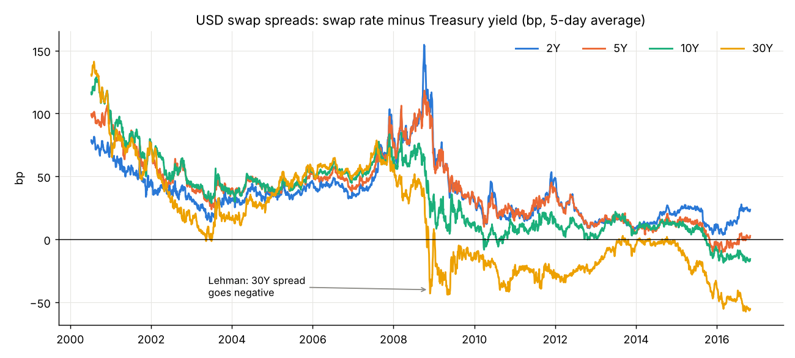
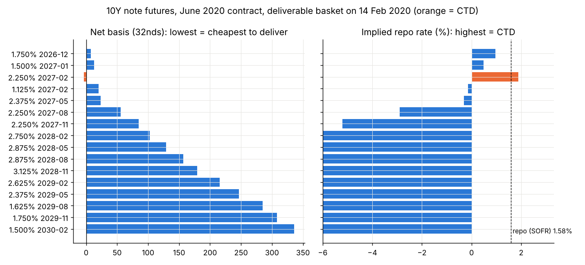
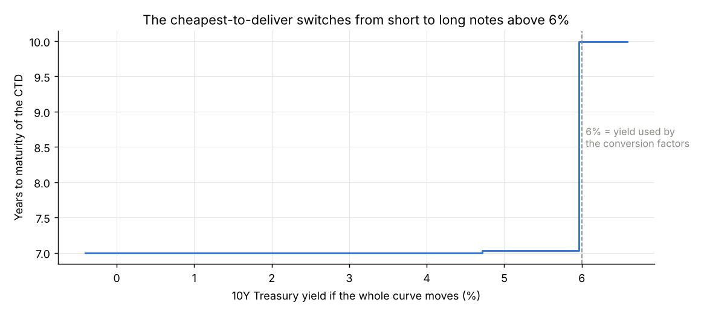
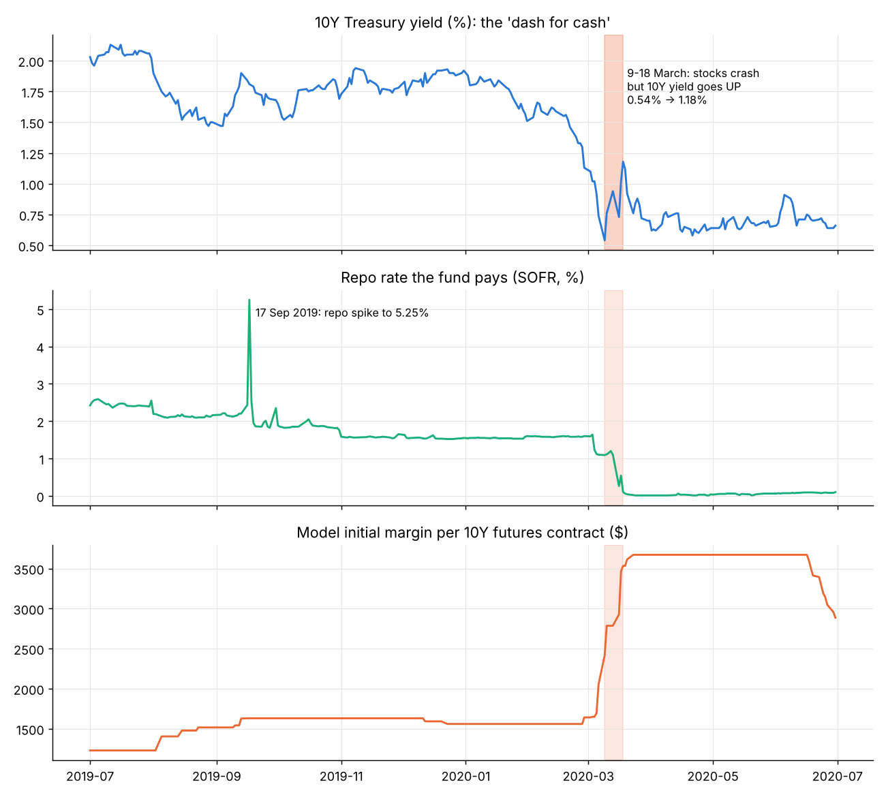
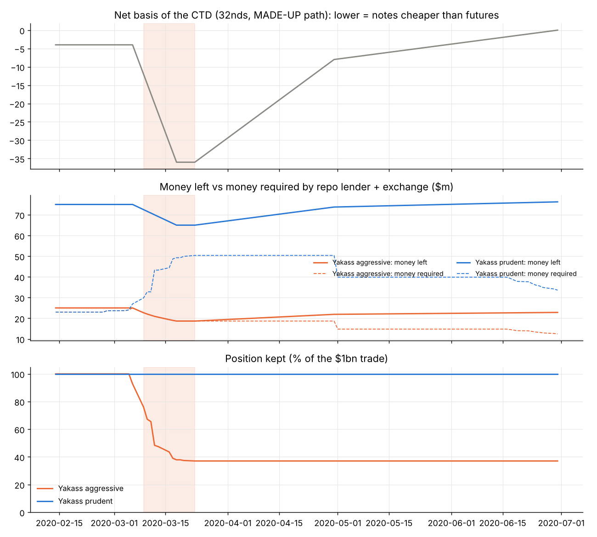
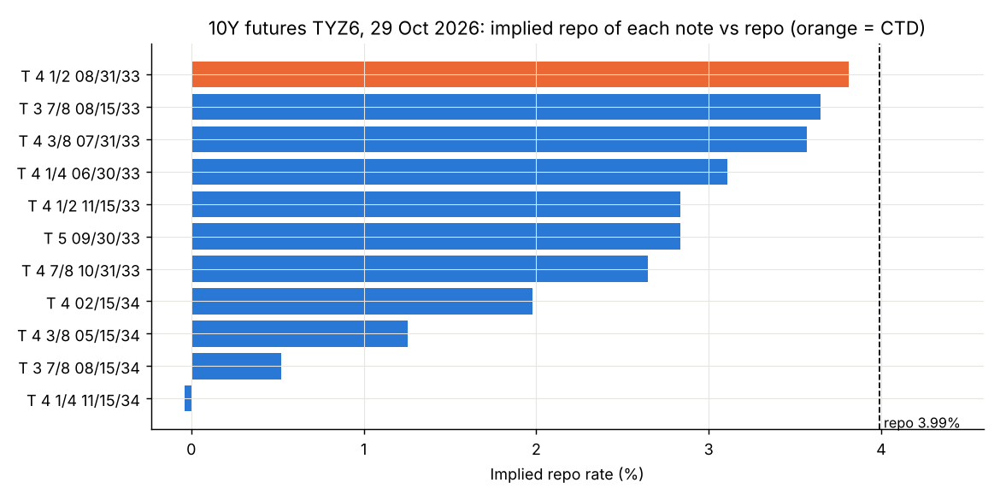

# Yakass Investment Management: a Treasury Basis Trade Case Study

**The setup.** I run a made-up relative value hedge fund, *Yakass Investment
Management*. In February 2020 the fund puts on the most popular trade in the rates
world: the **Treasury cash-futures basis trade**. One month later, COVID hits and the
Treasury market breaks. Does the fund survive?

The trade in one line: **buy a Treasury note, sell the Treasury futures on it, and
borrow the money in repo.** Rates risk cancels out. The fund earns the small gap between
the two prices, and makes it worth it with a lot of leverage.

The case follows the steps a desk would take:

1. **Why the trade exists**: swap spreads show that Treasuries became "cheap" after 2008.
2. **Entry screen (14 Feb 2020)**: futures basket, cheapest-to-deliver, basis, implied repo.
3. **Sizing**: capital, leverage, expected return.
4. **The story**: March 2020, two versions of Yakass with different leverage.
5. **Bonus, real Bloomberg data (29 Oct 2026)**: should Yakass enter today?

Real data: FRED (Treasury yields 2000-2026, USD swap rates 2000-2016, SOFR) and Bloomberg
screens of 29 Oct 2026. **Made up**: the path of the basis in March 2020 and the repo
haircuts, chosen to match what the Fed, BIS and OFR papers describe.

## 1. Why the trade exists: Treasuries became cheap

**Swap spread = swap rate − Treasury yield.** A bank should pay more than the US
government, so it used to be positive (+40 to +60bp before 2008).

| Average (bp) | 2Y | 5Y | 10Y | 30Y |
|---|---|---|---|---|
| 2000-2007 | 43 | 54 | 58 | 49 |
| 2010-2014 | 21 | 20 | 10 | −17 |
| 2015-2016 | 18 | 4 | −4 | −35 |
| **29 Oct 2026 (SOFR swaps)** | **−16** | **−34** | **−45** | |

The 30Y went negative right after Lehman, and today the whole curve is negative.
After 2008, regulation (the leverage ratio) makes it costly for banks to hold Treasuries,
so they stopped arbitraging the gap (Jermann, 2020). At the same time, asset managers
buy a lot of futures. Result: **futures are often rich and cash Treasuries cheap**.
Somebody has to sit in the middle: leveraged hedge funds.

## 2. Entry screen, 14 February 2020

**How the futures works.** The 10Y note futures (CME, TY) delivers $100k of a Treasury
note. The seller picks which note from a basket (6.5 to 10 years left). Each note has a
**conversion factor (CF)** = its price if it yielded 6%. The seller delivers the
**cheapest-to-deliver (CTD)**, the note with the highest implied repo.

| Measure | Formula | Meaning |
|---|---|---|
| Gross basis | price − futures × CF | cost of the note over its futures value |
| Carry | coupon − repo cost until delivery | what you earn holding the note |
| Net basis | gross basis − carry | below 0 = futures rich = trade makes money |
| Implied repo | return of: buy note, sell futures, deliver | must beat the repo rate |

I price the June 2020 basket off the real Treasury curve, with SOFR (1.58%) as repo,
and assume the futures is rich by 30bp (its implied repo is 1.88%).

| Note | Price | CF | Net basis | Implied repo |
|---|---|---|---|---|
| **2.25% Feb 2027 (CTD)** | 104.89 | 0.8006 | **−0.12 (−4/32)** | **1.88%** |
| 1.75% Dec 2026 | 101.60 | 0.7740 | 0.23 | 0.96% |
| 2.375% May 2027 | 105.86 | 0.8012 | 0.74 | −0.31% |

**Yakass decision: enter.** The implied repo beats repo by 30bp.

With yields below 6%, the CTD is always the shortest note. It would jump to the
longest note only if yields went above 6%:

## 3. Sizing

For $1bn of the CTD: buy the note in repo, sell **8,006 futures** ($1bn / $100k × CF).
The fund only puts up the repo haircut (1%) and the futures initial margin
(model: $1,561 per contract, from the real volatility of the 10Y yield).

| | |
|---|---|
| Capital needed | $23.0m for $1.05bn of notes |
| Leverage | 46x |
| Return on capital, 30bp edge | **14% per year** |

A 30bp gap becomes a 14% return. That is why the trade grew to more than half of all
hedge fund Treasury positions (Barth and Kahn, 2021).

## 4. The story: March 2020

What really happened (real data above): between 9 and 18 March the 10Y yield **rose**
from 0.54% to 1.18% while stocks crashed. Everyone sold Treasuries for cash, cash notes
fell more than futures, and my margin model goes from $1,561 to $3,671 per contract (×2.4).

**Two versions of Yakass** put on the same $1bn trade:

- **Yakass aggressive**: $25m of capital (40x), just above the $23m needed.
- **Yakass prudent**: $75m of capital (13x), the rest kept as cash.

Made-up path for the crisis: the net basis goes from −4/32 to **−36/32** on 18 March
(notes fall 1 point more than futures), stays there until the Fed promises unlimited
purchases on 23 March, then recovers to 0 at delivery in June. Repo haircuts go from 1%
to 2%. Each day, if the money left is below what the repo lender and the exchange ask
for, the fund must sell part of the trade.

| | Aggressive | Prudent |
|---|---|---|
| Capital | $25m | $75m |
| Leverage at entry | 40x | 13x |
| Lowest equity | $18.7m | $65.0m |
| Position kept | **37%** (forced to sell 6-23 March) | 100% |
| Final P&L | **−$2.2m (−8.7%)** | **+$1.25m (+1.7%)** |

**Same trade, opposite results.** The trade was right: by June the basis came back and
the prudent fund made its full 4/32. The aggressive fund was right too, but it was
forced to sell at the worst moment, locked in the losses and missed the recovery. Its
own selling (and that of funds like it) pushed the basis even wider.

This is close to what really happened: Field Street's relative value fund lost 14.5%
in March 2020 and had to cut positions, while Millennium's basis team, with capital to
spare, made a record $1.5bn in 2020 (Bloomberg).

## 5. Bonus: should Yakass enter today? (Bloomberg, 29 Oct 2026)

Same screen as in step 2, with the real Bloomberg DLV screens.

| | 10Y futures TYZ6 | 5Y futures FVZ6 |
|---|---|---|
| CTD | T 4½ 08/31/33 | T 3¾ 02/28/31 |
| Conversion factor | 0.9202 | 0.9090 |
| Implied repo | 3.81% | 3.60% |
| Repo to delivery | 3.99% | 4.00% |
| Edge | **−18bp** | **−40bp** |
| P&L if held to delivery, $1bn | −$305k | −$722k |
| **Decision** | **WAIT** | **WAIT** |

Today the futures is **cheap**, not rich: the CTD implied repo is below repo, so buying
the note and selling the futures loses money. Yakass stays flat and sets an alert: enter
when the implied repo is 10bp or more above repo. Knowing when **not** to trade is part
of the process.

## Conclusion

- The basis trade is "picking up pennies": a 30bp edge turned into 14% with 40-50x leverage.
- The risk is not rates (the futures hedge them). It is **funding and liquidity**: margin
  hikes, repo haircuts and a basis that widens exactly when everyone sells.
- So the real decision is **how much capital to keep aside**. Less leverage means a
  smaller return in normal times, but it lets the fund survive, and even buy more,
  when the basis blows out.
